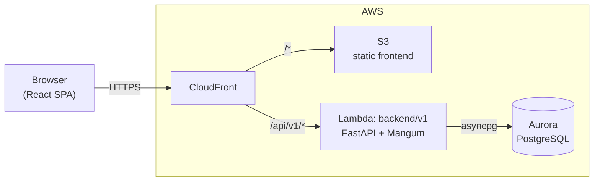
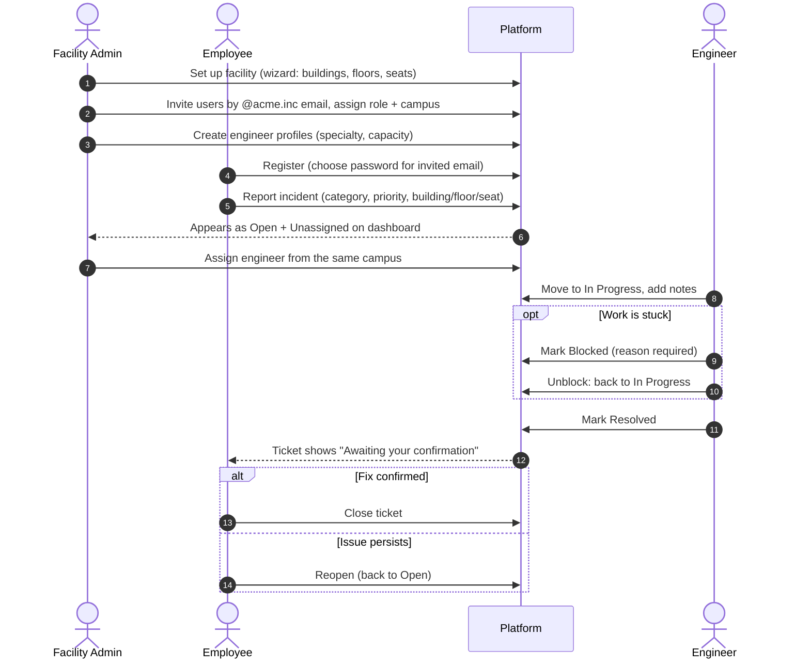
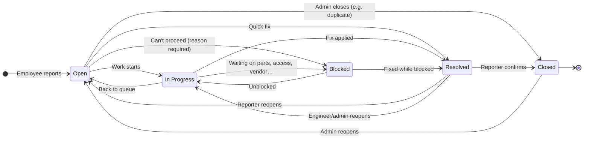
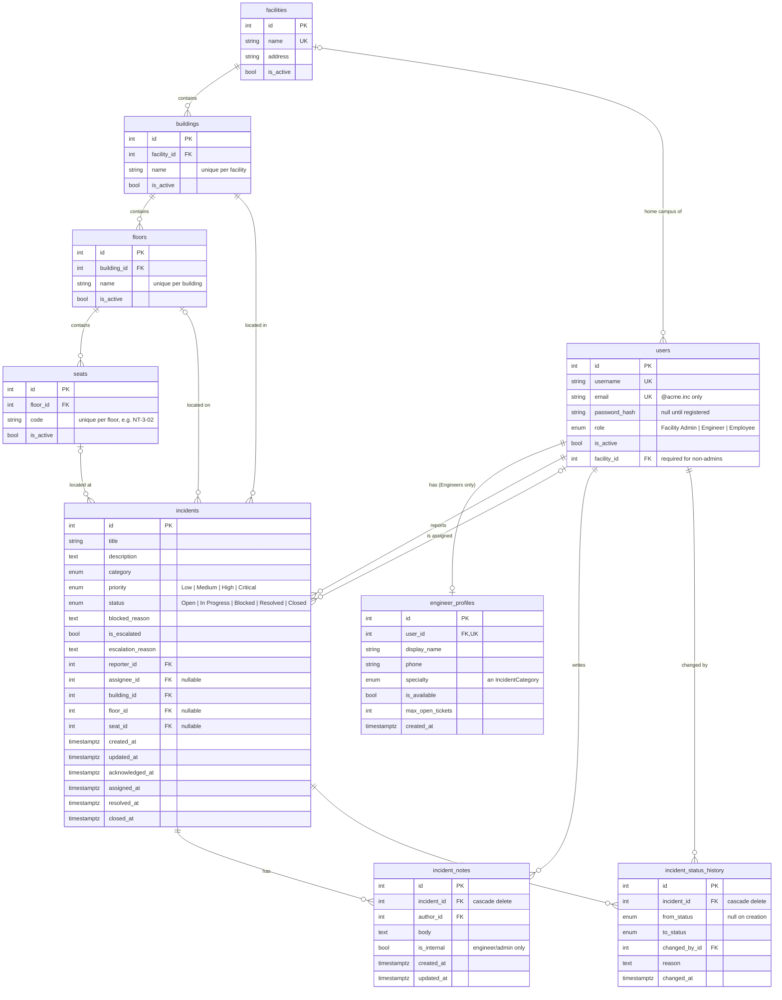

# ACME Facility Incident Platform

A self-service web application for reporting, tracking, and resolving facility and
workplace-technology issues across ACME's campuses: broken HVAC, flaky Wi-Fi,
a wobbly desk, a dead projector.

Before this, ACME handled issue reporting over email, chat, and manual trackers.
Employees couldn't see the progress of what they reported, facility admins had
no end-to-end view, and engineers had no consistent way to manage their work.
This platform puts all of it in one place, with role-based responsibilities and
a clear ticket lifecycle.

## Contents

- [Features](#features)
- [Tech Stack](#tech-stack)
- [Architecture](#architecture)
- [Roles & Permissions](#roles--permissions)
- [User Workflows](#user-workflows)
- [Ticket Lifecycle](#ticket-lifecycle)
- [Database Schema (ERD)](#database-schema-erd)
- [Dashboard & Analytics](#dashboard--analytics)
- [API Overview](#api-overview)
- [Project Structure](#project-structure)
- [Getting Started](#getting-started)

## Features

- **Authentication**: JWT bearer tokens, bcrypt password hashing, invite-only
  registration restricted to `@acme.inc` email addresses.
- **Role-based access control** for three personas (Employee, Engineer,
  Facility Admin), enforced on the backend and mirrored in the UI.
- **Multi-campus support**: users belong to a facility (campus). Employees and
  engineers only see their own campus. Admins can view all campuses or filter to
  any combination of them.
- **Facility hierarchy**: Facility → Building → Floor → Seat, with a
  **setup wizard** that generates a whole campus (buildings, floors, and
  auto-coded seats such as `NT-3-02`) in one step.
- **Incident workflow** with enforced status transitions (Open, In Progress,
  Blocked, Resolved, Closed), a required reason when a ticket is blocked or
  escalated, and a full status-change audit trail.
- **Incident notes**: a conversation thread on each ticket, including
  *internal* notes visible only to engineers and admins.
- **Engineer profiles** with specialty, availability, and a max open-ticket
  capacity, used for workload balancing.
- **Per-persona dashboard** covering open-ticket counts, SLA performance,
  trends, category breakdowns, location hotspots, engineer workload, and a
  "needs attention" list.
- **Search and filtering** on incidents by status, priority, category, location,
  assignee, escalation, and free text.
- **Responsive Material UI design** with light/dark themes.

## Tech Stack

| Layer          | Technology                                                                 |
| -------------- | -------------------------------------------------------------------------- |
| Frontend       | React 19, Vite, Material UI 9 (incl. MUI X Data Grid and Charts), Axios    |
| Backend        | Python, FastAPI, SQLAlchemy 2 (async) + asyncpg, Pydantic 2, PyJWT, bcrypt |
| Database       | PostgreSQL (Amazon Aurora PostgreSQL in AWS)                               |
| Serverless     | AWS Lambda via Mangum (ASGI → Lambda adapter)                              |
| Infrastructure | Terraform, S3, CloudFront, Secrets Manager, LocalStack for local dev       |
| CI             | GitHub Actions (Python, React, and Terraform workflows)                    |

## Architecture



- The whole API runs as a single FastAPI app (`backend/v1`) deployed as one Lambda
  function. Mangum translates Lambda events into ASGI requests under the
  `/api/v1` base path.
- The database sits inside a VPC, so schema creation and seeding run *inside*
  the Lambda (`{"action": "init_db"}`), triggered by `bin/init-database.sh`.
- The JWT signing secret is generated by Terraform and injected as an
  environment variable.

## Roles & Permissions

| Capability                                   | Employee           | Engineer                            | Facility Admin         |
| -------------------------------------------- | ------------------ | ----------------------------------- | ---------------------- |
| View dashboard                               | Own tickets        | Assigned tickets                    | All / chosen campuses  |
| Report an incident                           | ✅                 | ✅                                  | ✅                     |
| View incidents                               | Ones they reported | Assigned to or reported by them     | All                    |
| Edit incident details / location / priority  | Own, until closed  | —                                   | ✅                     |
| Request escalation                           | Own tickets        | —                                   | ✅                     |
| Change status                                | Resolved → Open/Closed only | Assigned tickets (not to/from Closed) | Any valid transition |
| Assign / reassign engineers                  | —                  | —                                   | ✅                     |
| Add notes                                    | ✅ (public)        | ✅ (public + internal)              | ✅ (public + internal) |
| View facilities                              | Via report form    | Own campus (read-only)              | ✅                     |
| Manage facilities / buildings / floors / seats | —                | —                                   | ✅                     |
| View engineer roster                         | —                  | ✅ (can update own phone/availability) | ✅                  |
| Manage engineer profiles and users           | —                  | —                                   | ✅                     |
| Delete incidents                             | —                  | —                                   | ✅                     |

Permissions are defined in two places that mirror each other:

- **Backend (source of truth):** `require_admin` / `require_role` dependencies,
  row-level visibility filters, and per-ticket `EDITABLE_FIELDS` in
  [backend/v1/app/routers/incidents.py](backend/v1/app/routers/incidents.py).
- **Frontend (UX only):** [frontend/src/auth/permissions.js](frontend/src/auth/permissions.js)
  hides navigation and actions a role can't use, and
  [frontend/src/auth/incidentRules.js](frontend/src/auth/incidentRules.js)
  offers only the status changes the backend will accept.

A ticket the user isn't allowed to see returns **404 rather than 403**, so other
people's ticket IDs aren't revealed.

## User Workflows

### End-to-end flow



### Employee

1. **Register.** A Facility Admin first creates an account for the employee's
   `@acme.inc` address. The employee then registers by choosing their own
   password and is logged in immediately.
2. **Report an incident.** Give it a title, description, category, and
   priority, plus a location. A building is required; floor and seat are
   optional, and the choices are limited to the employee's own campus.
3. **Track progress** from the dashboard ("My tickets") and the Incidents page,
   including the status timeline and public notes.
4. **Communicate** with the engineer by adding notes while the ticket is open.
5. **Escalate** if needed. This sets the escalation flag and requires a reason.
6. **Confirm the outcome.** Once a ticket is Resolved, the employee either
   **closes** it or **reopens** it.

### Engineer

1. Log in and see the tickets **assigned to them** on the dashboard and the
   Incidents page.
2. Keep the status current (Open → In Progress → Resolved), marking **Blocked**
   with a reason when they can't proceed.
3. Use **notes** to update the reporter, or **internal notes** for
   engineer/admin-only context.
4. Keep their **availability** and phone number up to date on the Engineers page.

### Facility Admin

1. **Define facilities.** Use the setup wizard (Facility → Buildings → Review)
   to create a campus with generated floors and seats, or manage each level
   individually. Locations that have incident history can be deactivated
   instead of deleted, so the history is kept.
2. **Manage users.** Invite users, set their role and campus, and deactivate
   accounts.
3. **Create engineer profiles** with specialty, availability, and max open
   tickets.
4. **Triage and assign** incoming tickets. Engineers can only be assigned to
   tickets at their own campus.
5. **Oversee the lifecycle.** Admins can edit any field, make any valid status
   transition, reopen closed tickets, and delete tickets.
6. **Monitor** SLA performance, hotspots, and workload across one or more
   campuses from the dashboard.

## Ticket Lifecycle

Every ticket starts as **Open** and unassigned. Status changes are validated
against a fixed transition map; anything else is rejected with `400`.



### Who can make each move

| Actor                   | Allowed transitions                                                       |
| ----------------------- | ------------------------------------------------------------------------- |
| **Facility Admin**      | Any transition shown above                                                 |
| **Assigned Engineer**   | Any transition that doesn't go to or from **Closed**                       |
| **Reporter (Employee)** | Only **Resolved → Closed** (confirm) or **Resolved → Open** (reopen)       |

### Rules and side effects

- **Blocked** requires a `blocked_reason`. The reason is cleared automatically
  when the ticket leaves Blocked and is kept in the status history.
- **Escalation** (`is_escalated`) is a flag set alongside the status and
  requires an `escalation_reason`.
- **Lifecycle timestamps** feed the reporting:
  - `acknowledged_at` is set the first time anyone changes the status.
  - `assigned_at` is set or cleared when the assignee changes.
  - `resolved_at` and `closed_at` are set on those transitions and cleared if the
    ticket is reopened.
- Every status change writes a row to `incident_status_history` (from, to, who,
  when, why). This drives the ticket's timeline view.
- **Closed** tickets are read-only for reporters and engineers, who also can't
  add notes to them. Only an admin can reopen a closed ticket.

## Database Schema (ERD)



**Design notes**

- An incident stores `building_id`, `floor_id`, and `seat_id` directly, rather
  than only the most specific one, so "which locations have the most issues"
  is a simple `GROUP BY`. The API checks that the seat is on the floor and the
  floor is in the building.
- An incident's facility comes from its building, so tickets automatically
  belong to the right campus.
- The lifecycle timestamps on `incidents` duplicate what `incident_status_history`
  records, so dashboards don't have to scan the history table.
- **Incident categories:** HVAC, Electrical, Plumbing, Furniture, Cleaning,
  Security / Access, Network / Wi-Fi, Hardware, AV Equipment, Other.
- Models live in [backend/v1/app/models/](backend/v1/app/models/). Tables are
  created with SQLAlchemy `create_all`; there is no migration tool yet.

## Dashboard & Analytics

`GET /analytics/dashboard` returns everything the dashboard needs in a single
request, limited to what the caller is allowed to see. It answers the key
business questions:

| Business question                                        | Where it's answered                                                   |
| -------------------------------------------------------- | --------------------------------------------------------------------- |
| What incidents are open, and what's their status?        | Current snapshot: counts by status and priority                       |
| Which buildings/floors/seats have recurring issues?      | Hotspots card (repeat issues in the same category at one location)    |
| How quickly are incidents acknowledged/assigned/resolved? | Timing stats and SLA card                                            |
| Which engineers are available, and how is work spread?   | Workload card (open tickets vs. capacity, availability)               |
| What are the most common issue categories?               | Category chart                                                        |
| Which incidents are escalated or blocked, and why?       | "Needs attention" list, with reasons                                  |
| How well are employees kept informed?                    | Communication stats ("silent" tickets with no visible update)         |

**SLA resolve targets:** Critical 4h · High 24h · Medium 72h · Low 120h. A
ticket counts as *at risk* once 75% of its target time has passed.

**Attention flags**, in order of urgency: SLA breached, Blocked, Escalated,
Unassigned (Critical/High immediately, others after 24h), Awaiting reporter
confirmation, and Silent (no reporter-visible update in 3 days).

## API Overview

Interactive OpenAPI docs are served by FastAPI at `/docs` (base path `/api/v1`).

| Area        | Endpoints                                                                                              |
| ----------- | ------------------------------------------------------------------------------------------------------ |
| Auth        | `POST /auth/token` · `POST /auth/register` · `GET /auth/me` · `POST /auth/change-password`             |
| Users       | `GET/POST /users` · `GET/PATCH/DELETE /users/{id}` (admin)                                             |
| Facilities  | CRUD on `/facilities`, `/buildings`, `/floors`, `/seats` · `GET /{resource}/{id}/delete-impact`        |
| Setup       | `POST /facilities/setup` · `POST /facilities/{id}/buildings/bulk`                                     |
| Engineers   | `GET/POST /engineers` · `GET/PATCH/DELETE /engineers/{id}`                                             |
| Incidents   | `GET/POST /incidents` · `GET/PATCH/DELETE /incidents/{id}` · `GET /incidents/{id}/history`             |
| Notes       | `GET/POST /incidents/{id}/notes` · `PATCH/DELETE /incidents/{id}/notes/{note_id}`                      |
| Analytics   | `GET /analytics/dashboard?start=&end=&facility_id=&building_id=&tz=`                                   |
| Health      | `GET /health`                                                                                          |

## Project Structure

```
coding-workshop-participant/
├── backend/
│   └── v1/                        # The API (deployed as one Lambda)
│       ├── function.py            # Lambda entrypoint (HTTP + init_db action)
│       ├── app/
│       │   ├── main.py            # FastAPI app, routers, error handlers
│       │   ├── models/            # SQLAlchemy models (tables)
│       │   ├── schemas/           # Pydantic request/response models
│       │   ├── routers/           # auth, users, facilities, engineers, incidents, analytics
│       │   ├── facility_scope.py  # Campus-level visibility rules
│       │   ├── security.py        # bcrypt + JWT helpers
│       │   └── dependencies.py    # DB session, current user, role guards
│       └── scripts/               # create_tables, seed_users, seed_sample_data, init_db
├── frontend/
│   └── src/
│       ├── pages/                 # Dashboard, Incidents, Facilities, Engineers, Users
│       ├── components/            # dashboard cards, incident notes/history, setup wizard, layout
│       ├── auth/                  # permissions.js, incidentRules.js
│       ├── context/               # Auth, color mode, navigation
│       ├── hooks/ services/ api/  # data fetching + axios client
│       └── theme.js               # MUI light/dark theme
├── infra/                         # Terraform (Lambda, RDS, S3, CloudFront, secrets)
├── bin/                           # Dev + deployment scripts
└── docs/                          # Workshop guides
```

## Getting Started

### Prerequisites

PostgreSQL, Node.js/npm, Python 3, Terraform, the AWS CLI, `jq`, and LocalStack
(for local development). See [bin/README.md](bin/README.md) for details.

### Run locally

```sh
./bin/start-dev.sh
```

This starts PostgreSQL and LocalStack, deploys the backend Lambda to LocalStack
with Terraform, and launches the Vite dev server at `http://localhost:3000`.
The API is proxied at `http://localhost:3001`.

To create tables and seed test users plus sample data:

```sh
./bin/init-database.sh local
```

Locally, the seeded accounts use the password `password123`:

| Username   | Email                   | Role           |
| ---------- | ----------------------- | -------------- |
| `admin`    | `testadmin@acme.inc`    | Facility Admin |
| `engineer` | `testengineer@acme.inc` | Engineer       |
| `employee` | `testemployee@acme.inc` | Employee       |

The sample data includes two campuses (ACME HQ Campus and ACME West Campus) with
buildings, engineers, and a spread of incidents for the dashboards.

### Deploy to AWS

```sh
./bin/deploy-backend.sh aws     # Terraform apply + database init
./bin/deploy-frontend.sh aws    # Build and upload the SPA to S3/CloudFront
```

In AWS, seeded accounts get a random password that is printed once. You can
set your own with `SEED_PASSWORD=... ./bin/init-database.sh aws`.

### Clean up

```sh
./bin/cleanup-environment.sh
```

> **Warning:** this destroys all deployed AWS resources and cannot be undone.

## Contributing

See [CONTRIBUTING](./CONTRIBUTING.md).

## License

Licensed under the MIT-0 License. See [LICENSE](./LICENSE).

## Security

See [Security Issue Notifications](./CONTRIBUTING.md#security-issue-notifications).
